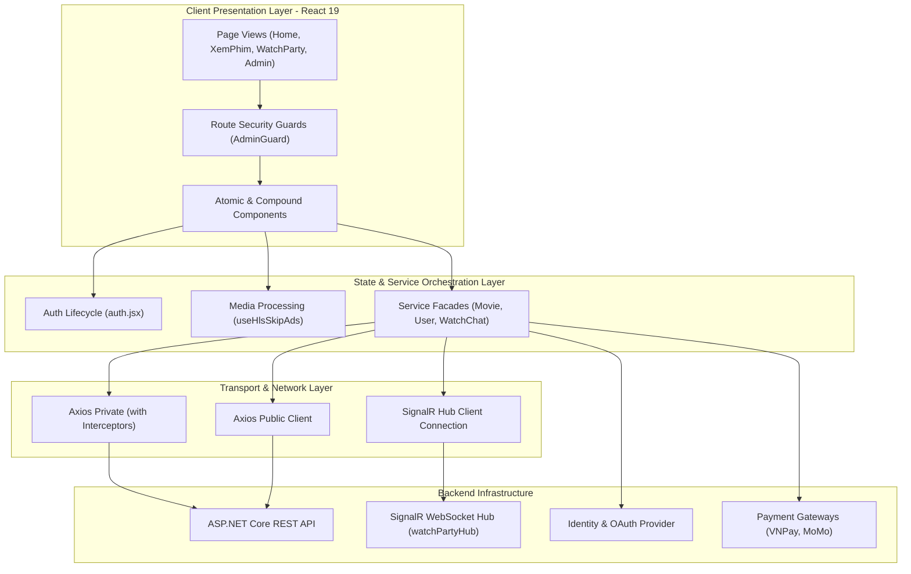

<div align="center">

# GienPhim Frontend Client

### Enterprise-Grade Video Streaming Platform with Realtime WatchParty Synchronization

[](https://react.dev/)
[](https://reactrouter.com/)
[](https://dotnet.microsoft.com/apps/aspnet/signalr)
[](https://github.com/video-dev/hls.js/)
[](https://tailwindcss.com/)
[](LICENSE)

<p align="center">
  <a href="#1-project-overview">Project Overview</a> &bull;
  <a href="#2-core-capabilities">Core Capabilities</a> &bull;
  <a href="#3-role-based-feature-matrix">Feature Matrix</a> &bull;
  <a href="#4-system-highlights">System Highlights</a> &bull;
  <a href="#5-application-architecture">Architecture</a> &bull;
  <a href="#6-quickstart-guide">Quickstart</a> &bull;
  <a href="#7-documentation-hub">Documentation Hub</a> &bull;
  <a href="#8-deployment--build">Deployment</a> &bull;
  <a href="#9-license">License</a>
</p>

</div>

---

> [!IMPORTANT]
> **Runtime Prerequisites & Production Environment Warning**
> 1. This application mandates a Node.js runtime environment of version 18.x or 20.x LTS.
> 2. Real-time WatchParty synchronization and automated token rotation require continuous connectivity to the upstream backend REST API and the SignalR WebSocket Hub (`watchPartyHub`).
> 3. Verify that all target backend endpoints and Google OAuth credentials in `.env` are configured prior to executing production builds.

---

## 1. Project Overview

### 1.1 Problem Statement
Modern video streaming web applications frequently suffer from high latency during distributed co-watching sessions, complex token synchronization issues resulting in dropped sessions, inefficient handling of server-side ad insertions (SSAI), and monolithic administrative overhead when importing large media catalogs from external upstream APIs.

### 1.2 Proposed Solution
GienPhim Frontend is an enterprise-oriented Single Page Application (SPA) engineered with React 19, Microsoft SignalR, and Hls.js. It delivers:
- **Low-Latency Co-Watching**: Bi-directional playback synchronization (play, pause, seek, episode transition) and live group chat over native WebSockets.
- **Adaptive Stream Playback**: High-performance HLS streaming equipped with autonomous discontinuity-based ad-skipping algorithms.
- **Resilient Security**: Silent dual-token refresh rotation via HTTP interceptors and claim-based Role-Based Access Control (RBAC).
- **Integrated Commercial Infrastructure**: Tiered subscription billing and multi-gateway digital wallet top-up processing (VNPay, MoMo, Bank Transfer).
- **Automated Content Governance**: Full-featured administrative CMS alongside scheduled crawler bot automation controls.

---

## 2. Core Capabilities

### 2.1 Collaborative WatchParty (Realtime Co-Watching)
- **Room Orchestration**: Users can create private or discoverable co-watching rooms bound to specific movie titles.
- **Synchronized Playback Engine**: Room hosts broadcast playback events (`play`, `pause`, `seek`, `changeEpisode`) to all connected members via the SignalR WebSocket Hub. An internal state lock prevents circular event reflection.
- **Bi-Directional Chat Pipeline**: High-throughput room chat accompanied by on-demand participant identity resolution and automatic message scrolling.
- **Admission Management**: Room hosts evaluate and accept or decline incoming join requests dynamically.

### 2.2 Streaming Playback & Intelligent Ad-Bypass
- **Dual-Source HLS Engine**: Automatically resolves primary `.m3u8` streams and secondary provider wrapper URLs.
- **Autonomous Discontinuity Ad Detection**: Analyzes HLS manifest fragments for `#EXT-X-DISCONTINUITY` boundaries, determining ad segments and automatically advancing playback past commercial breaks without user intervention.
- **Responsive Layout & State Preservation**: Dynamically tracks episode progress, view counts, and user interaction states (Like/Dislike).

### 2.3 Identity, RBAC & Session Management
- **Federated Authentication**: Integrates Google Identity Services (GSI) OAuth 2.0 and native credential authentication.
- **Interception & Silent Rotation**: Intercepts expired requests and automatically rotates JSON Web Tokens (JWT) using refresh tokens prior to re-dispatching pending calls.
- **Declarative Route Security**: Protects administrative corridors using client-side route guards (`AdminGuard`) inspecting cryptographic claims.

### 2.4 Digital Commerce & Subscription Economy
- **Membership Tier Management**: Browsing and purchasing of customizable membership packages (e.g., standard, VIP, monthly, annual).
- **Integrated Financial Gateways**: Direct gateway checkout via VNPay, MoMo E-Wallet, and automated manual bank transfer with QR invoice generation.
- **Transaction Auditing**: End-to-end ledger tracking user balance adjustments and subscription renewals.

### 2.5 Administrative Content Management & Crawler Automation
- **Catalog Lifecycle Management**: Comprehensive CRUD operations across films, episodes, taxonomies (genres, tags, countries, languages), and personnel (actors, directors).
- **Automated Ingestion Bot**: Configurable background crawler daemon with tunable interval cadences and batch retrieval limits.
- **Operational Metrics**: Real-time analytical dashboard monitoring view distribution, user registrations, and gross transaction metrics.

---

## 3. Role-Based Feature Matrix

| Functional Module | Anonymous Guest | Registered Member | VIP Subscriber | System Administrator |
| :--- | :---: | :---: | :---: | :---: |
| Browse Catalog & Search | Supported | Supported | Supported | Supported |
| Standard Movie Streaming | Supported | Supported | Supported | Supported |
| Automatic Ad-Skipping Engine | Supported | Supported | Supported | Supported |
| View History & Personal Library | Not Applicable | Supported | Supported | Supported |
| Submit Comments & Ratings | Not Applicable | Supported | Supported | Supported |
| Host / Join WatchParty Rooms | Not Applicable | Supported | Supported | Supported |
| Digital Wallet Top-Up (VNPay/MoMo) | Not Applicable | Supported | Supported | Supported |
| Purchase Premium Membership Tiers | Not Applicable | Supported | Supported | Supported |
| Access Exclusive VIP Content | Not Applicable | Restricted | Supported | Supported |
| Administrative Metrics Dashboard | Not Applicable | Not Applicable | Not Applicable | Supported |
| Media & Taxonomy Management | Not Applicable | Not Applicable | Not Applicable | Supported |
| User & Role Access Control | Not Applicable | Not Applicable | Not Applicable | Supported |
| Crawler Bot Cadence Configuration | Not Applicable | Not Applicable | Not Applicable | Supported |

---

## 4. System Highlights

| Capability | Module / Service | Technical Description |
| :--- | :--- | :--- |
| **Realtime Synchronization** | `WatchPartyLayout`, `PlayerPanel`, `SignalR` | WebSockets transport leveraging `@microsoft/signalr` with automatic reconnection and circular event loop prevention. |
| **Adaptive Video Engine** | `FilmVideo`, `useHlsSkipAds`, `Hls.js` | Discontinuity fragment parser reading `#EXT-X-DISCONTINUITY` tags to execute programmatic seeking past ad sequences. |
| **Silent Token Lifecycle** | `ApiHelper`, `auth.jsx`, `Axios` | Preemptive token expiration validation and reactive 401 retry interceptor with token storage synchronization. |
| **Role-Based Guards** | `AdminGuard`, `AppRoutes` | Declarative route boundary evaluating claims `nameidentifier` and `role` before permitting navigation. |
| **Automated Catalog Sync** | `BotConfigCard`, `MovieService` | Administrative control surface managing background crawler workers with configurable sync frequency and volume. |
| **Multi-Channel Payments** | `PhuongThucThanhToan`, `ThanhToan` | Unified payment interface routing orders to VNPay, MoMo, and direct banking endpoints. |

---

## 5. Application Architecture



---

## 6. Quickstart Guide

### Step 1: Clone Repository and Configure Environment
Clone the repository and initialize the local environment configuration from the template:

```bash
# Clone source repository
git clone https://github.com/hoangfhisp/GienPhimFe_React.git
cd GienPhimFe_React

# Initialize environment configuration
cp .env.example .env
```

Review and adjust `.env` parameters:
```env
REACT_APP_GIENPHIM_BE_API_URL=http://localhost:5000/api
REACT_APP_GIENPHIM_BE_URL=http://localhost:5000/
REACT_APP_GOOGLE_CLIENT_ID=your-google-oauth-client-id.apps.googleusercontent.com
PORT=3000
```

### Step 2: Install System Dependencies
Install the exact dependency tree:

```bash
npm install
```

### Step 3: Run the Application
Execute the development server or build for production:

```bash
# Run in local development mode (Hot Reloading enabled)
npm start

# Compile production bundle
npm run build

# Run unit tests
npm test
```

The application will be accessible at `http://localhost:3000`.

---

## 7. Documentation Hub

For exhaustive technical references, consult the dedicated technical documents in the `docs/` directory:

| Document | Subject Area | Description |
| :--- | :--- | :--- |
| [System Design Specification](docs/SYSTEM_DESIGN.md) | Architecture & Workflows | Layered design, component topology, and Mermaid sequence diagrams. |
| [Realtime & Data Pipeline](docs/REALTIME_OR_DATA_PIPELINE.md) | WebSockets & SignalR | Real-time synchronization mechanics, hub contracts, and reconnection policies. |
| [Integration & Native Engine](docs/NATIVE_OR_INTEGRATION_ENGINE.md) | Third-Party Protocols | HLS ad-skipping engine, Google OAuth, payment gateways, and crawler bots. |
| [RESTful API Specification](docs/API_SPECIFICATION.md) | Network Endpoints & DTOs | Complete catalog of HTTP endpoints, query schemas, and payload specifications. |
| [State & Security Architecture](docs/STATE_AND_SECURITY.md) | Security & Access Control | JWT lifecycle, refresh token rotation, RBAC guards, and client security. |
| [Enterprise Deployment Guide](docs/DEPLOYMENT_GUIDE.md) | Production Operations | Multi-stage Docker packaging, Nginx tuning, and environment management. |

---

## 8. Deployment & Build

The application supports multiple deployment form factors:

1. **Docker Containerization**: Multi-stage Dockerfile compiling assets on Node 20 Alpine and serving static bundles through Nginx Alpine (under 30MB footprint).
2. **Reverse Proxy (Nginx / Apache)**: Static hosting with SPA fallback rules (`try_files $uri $uri/ /index.html;`) and HTTP/2 SSL termination.
3. **Cloud & CDN Hosting**: Compatible with platforms such as AWS S3 + CloudFront, Vercel, Netlify, and Cloudflare Pages.

Detailed container manifests and Nginx configuration templates are documented in the [Enterprise Deployment Guide](docs/DEPLOYMENT_GUIDE.md).

---

## 9. License

This project is licensed under the open-source [MIT License](LICENSE).
