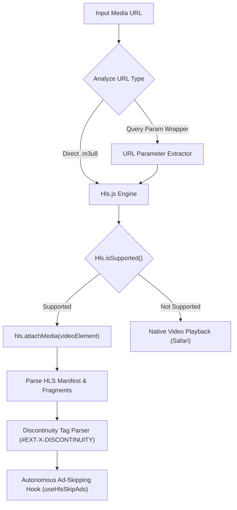
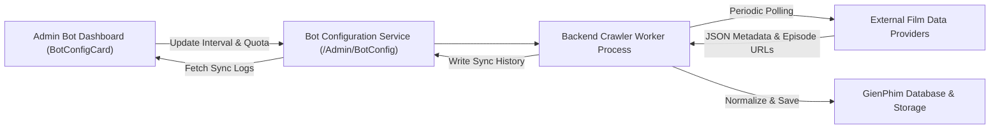

# Integration & Native Engine Specifications

## 1. Overview

GienPhim integrates multiple third-party protocols, hardware media players, and external services to deliver streaming, security, financial transactions, and automated content synchronization.

---

## 2. Video Streaming & HLS Ad-Skipping Engine

### 2.1 HLS Media Pipeline

Streaming playback is powered by `Hls.js` (HTTP Live Streaming) combined with HTML5 video elements. The playback engine dynamically determines source availability:
- **Primary Source (`linkChinh`)**: Native `.m3u8` playlist stream delivered via CDN.
- **Secondary Source (`linkPhu`)**: Embedded stream or URL parameter wrapper (`?url=...m3u8`).
- **Native Fallback**: Native browser HLS decoding for Safari / WebKit engines.



### 2.2 Server-Side Ad Insertion (SSAI) Auto-Skipper

The custom hook `useHlsSkipAds` inspects HLS fragments during the `LEVEL_LOADED` event:
1. Identifies discontinuities using `#EXT-X-DISCONTINUITY` (`tag[0] === 'DIS'`).
2. Calculates ad duration boundaries (`start` and `end` timestamps).
3. Evaluates fragment segment tags to distinguish between mid-roll advertisements and legitimate film content (advertisement blocks have duration `< 120` seconds and lack standard episode continuity tags).
4. Monitors playback time via `timeupdate`. When `currentTime` enters a recognized ad range, the engine executes an atomic seek operation (`video.currentTime = target.end + 0.2`) to seamlessly skip past commercial interruptions.

---

## 3. Google Identity Services (GSI) OAuth 2.0 Engine

Authentication integrates with Google OAuth 2.0 using the modern Google Identity Services library (`https://accounts.google.com/gsi/client`).

### 3.1 Initialization & Authentication Sequence

```mermaid
sequenceDiagram
    autonumber
    participant Client as Browser (Login Page)
    participant GoogleSDK as Google Identity Services SDK
    participant AuthAPI as GienPhim Backend (/Auth/LoginGoogleToken)
    participant DB as System Identity Store

    Client->>GoogleSDK: Load script asynchronously (google-gsi-client)
    GoogleSDK-->>Client: SDK Ready
    Client->>GoogleSDK: google.accounts.id.initialize({ client_id, callback })
    Client->>GoogleSDK: google.accounts.id.renderButton(googleBtnRef)
    
    Note over Client, GoogleSDK: User authenticates with Google Account
    GoogleSDK->>Client: Execute callback(response) returning JWT ID Token
    Client->>AuthAPI: POST /Auth/LoginGoogleToken { idToken }
    AuthAPI->>AuthAPI: Validate ID Token against Google Public Certs
    AuthAPI->>DB: Query or provision user account
    AuthAPI-->>Client: HTTP 200 { token, refreshToken, userProfile }
    Client->>Client: Store tokens in LocalStorage; Navigate to /Home
```

---

## 4. Payment Gateway Integrations

The subscription and digital wallet system supports three payment processing channels:

### 4.1 VNPay E-Wallet & Banking Gateway
- **Endpoint**: `/Payment/CreatePaymentVnPay`
- **Method**: Asynchronous invocation passing `userId`, `soTien` (amount), and `motaDH` (order description).
- **Behavior**: Backend signs payment parameters using HMAC-SHA512 and returns a cryptographically secure payment URL. The frontend redirects the user to the VNPay hosted checkout page.

### 4.2 MoMo E-Wallet Gateway
- **Endpoint**: `/Payment/CreatePaymentMomo`
- **Method**: Sends `napTienDto` and `userId`.
- **Behavior**: Generates QR code payloads and deep-link URI schemas for mobile app switching and web payments.

### 4.3 Direct Bank Transfer (VIB Manual Gateway)
- **Workflow**:
  1. Frontend submits transaction registration: `taoGiaoDich(napTienDto)`.
  2. Displays transaction reference code and QR code for scanning.
  3. Client can poll or execute confirmation `xacNhanChuyenTien()` or cancellation `huyGiaoDich()`.

---

## 5. Automated Film Crawler & Ingestion Bot

To maintain an up-to-date catalog, the administrative module interfaces with an automated crawler daemon.



### 5.1 Bot Controls & Parameters
1. **Toggle Active Status (`enabled`)**: Enables or suspends background automated crawl executions.
2. **Quota Per Run (`apiPerRun`)**: Configures the batch quantity of movies fetched per sync interval.
3. **Execution Cadence (`intervalHours`)**: Establishes the schedule frequency in hours.
4. **Sync Log Tracking (`fetchBotSyncLogs`)**: Fetches historical ingestion metrics including processed movies, success rates, and network errors.
