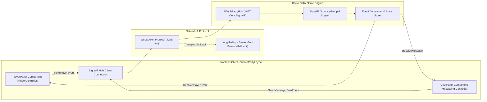

# Realtime & Data Pipeline Architecture

## 1. Overview

The real-time collaborative system in GienPhim enables multiple users to synchronize media playback and communicate through high-frequency group messaging in real time. The implementation relies on `@microsoft/signalr` communicating with the backend `watchPartyHub` over persistent WebSockets.

---

## 2. Realtime Transport Architecture

The real-time pipeline is designed for minimal latency and reliable event delivery. The client leverages direct WebSocket transport with automatic fallback and state reconciliation.



---

## 3. SignalR Hub Contract & Events

### 3.1 Client Invocations (Client to Server)

| Method Name | Parameters | Description |
| :--- | :--- | :--- |
| `JoinRoom` | `groupId: string` | Registers the current SignalR connection into the specified room group channel. |
| `SendMessage` | `groupId: string, userId: string, message: string` | Dispatches a chat message to all peers connected to the specified room. |
| `SendPlayerEvent` | `groupId: string, eventType: string, data: any` | Broadcasts playback control actions (play, pause, seek, changeEpisode) to group members. |

### 3.2 Server Broadcast Events (Server to Client)

| Event Name | Payload Structure | Processing Behavior |
| :--- | :--- | :--- |
| `ReceiveMessage` | `{ userId: string, message: string, timestamp: string }` | Appends new message to message list; triggers user metadata fetch if not present in cache. |
| `ReceivePlayerEvent` | `eventType: string, data: any` | Executes coordinated player control on the HTML5/HLS video element while suppressing local echo loops. |

---

## 4. Player Synchronization Engine

Coordinating video playback across distributed clients requires handling latency variations and preventing circular event cascades.

### 4.1 Supported Playback Events

1. **play**: Synchronizes the media element playback state across all connected participant browsers.
2. **pause**: Halts the media stream across all participant viewports simultaneously.
3. **seek**: Synchronizes current playback timestamp (`videoRef.current.currentTime = targetTime`).
4. **changeEpisode**: Transitions all clients to a new episode by reconstructing the episode DTO and reloading the HLS playlist source.

### 4.2 Circular Loop Mitigation Algorithm

When an event arrives from the server, executing the command natively on `<video>` will fire native browser events (such as `onPlay`, `onPause`, `onSeeked`). To prevent an infinite broadcast cycle, an atomic ref flag (`isSyncingRef`) is utilized:

```javascript
// Step 1: Set synchronization lock prior to updating player state
isSyncingRef.current = true;

// Step 2: Apply remote instruction
if (eventType === "seek") {
    videoRef.current.currentTime = data;
}

// Step 3: Release lock after dispatch window
setTimeout(() => {
    isSyncingRef.current = false;
}, 150);
```

When local player events trigger, handlers inspect `isSyncingRef.current`. If `true`, the event was initiated remotely and will not be re-broadcasted to the SignalR Hub.

---

## 5. Connection Lifecycle & Reconnection Strategy

### 5.1 Connection Setup Rules

The client follows a strict registration sequence to prevent missed events:
1. Initialize `HubConnectionBuilder` configuring the target Hub URL.
2. Specify WebSockets transport explicitly (`signalR.HttpTransportType.WebSockets`).
3. Enable `withAutomaticReconnect()` to handle network drops.
4. **Register all event listeners (`connection.on(...)`) before calling `connection.start()`**.
5. Once `connection.start()` resolves, invoke `JoinRoom(groupId)`.

### 5.2 Automatic Reconnection & Cleanup

- Automatic reconnect executes an exponential backoff retry pattern (0s, 2s, 10s, 30s).
- On component unmount, all active listeners are unregistered via `connection.off("ReceiveMessage")` and the connection is cleanly closed via `connection.stop()` to eliminate memory leaks and dangling socket connections.

---

## 6. Chat Pipeline & Identity Caching

The chat pipeline operates with an on-demand identity resolution cache to avoid redundant REST queries:

1. When a new message arrives with `userId`, the client checks the in-memory dictionary `usersById[userId]`.
2. If absent, an asynchronous request to `AuthenticationService.getUserById(userId)` is dispatched.
3. The returned user profile (username, avatar) is saved into state, immediately resolving the visual identity across current and subsequent messages.
4. An attached `messagesEndRef` smoothly scrolls the viewport to the latest message whenever the message collection updates.
