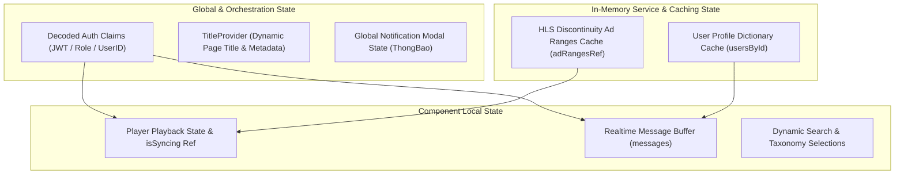
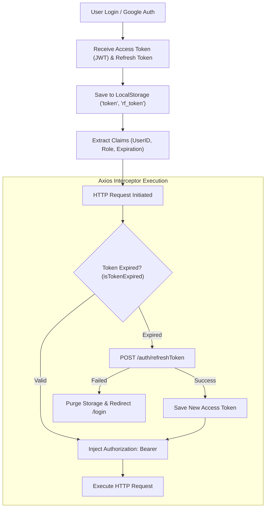

# State Management & Security Architecture

## 1. Overview

This document details the state lifecycle, authentication pipelines, Role-Based Access Control (RBAC), and transmission security safeguards implemented across the GienPhim frontend application.

---

## 2. State Management Strategy

GienPhim employs a decoupled state architecture tailored for streaming workloads, avoiding unnecessary monolithic re-renders:



### 2.1 State Categorization
1. **Global & Orchestration State**: Managed via dedicated context wrappers and centralized helpers (`auth.jsx`, `TitleProvider.jsx`). Synchronizes user credentials and document titles across route transitions.
2. **In-Memory Service Caching**: Ephemeral lookups (`usersById`, `adRangesRef`) avoid duplicate network roundtrips during streaming sessions and high-throughput chat activity.
3. **Local Component State**: Encapsulated using React hooks (`useState`, `useRef`, `useMemo`). High-frequency mutations (e.g. video time updates) utilize mutable React refs (`isSyncingRef`, `videoRef`) to bypass costly virtual DOM reconciliations.

---

## 3. Authentication & Token Management Lifecycle

The platform implements dual-token authentication featuring JSON Web Tokens (JWT) with automatic token rotation.



### 3.1 Claim Extraction Specifications

The application reads standard WS-Federation claims embedded within the ASP.NET Core Identity JWT payload:

| Claim Property | Claim Uniform Resource Identifier | Frontend Extraction Method |
| :--- | :--- | :--- |
| **User ID** | `http://schemas.xmlsoap.org/ws/2005/05/identity/claims/nameidentifier` | `getUserIdFromToken()` |
| **Role Name** | `http://schemas.microsoft.com/ws/2008/06/identity/claims/role` | `getRolseUserFromToken()` |
| **Expiration** | `exp` | `isTokenExpired(token)` |

---

## 4. Role-Based Access Control (RBAC) & Route Guards

Access to privileged application sectors is strictly protected by client-side route guards backed by server-side endpoint verification.

### 4.1 Route Guard Implementation (`AdminGuard`)

```javascript
export default function AdminGuard() {
    const userId = getUserIdFromToken();
    const role = getRolseUserFromToken();

    // 1. Unauthenticated redirect
    if (!userId) {
        return <Navigate to="/login" replace />;
    }

    // 2. Insufficient privilege redirect
    if (role !== "Admin") {
        return <Navigate to="/Home" replace />;
    }

    // 3. Authorized access permitted
    return <Outlet />;
}
```

### 4.2 Permission Level Matrix

| Route Path | Guest Visitor | Authenticated User | System Administrator |
| :--- | :--- | :--- | :--- |
| `/Home`, `/Phim/:id`, `/XemPhim/:id/:tap` | Allowed | Allowed | Allowed |
| `/History`, `/InfoAccount` | Blocked (Redirect /login) | Allowed | Allowed |
| `/GoiThanhVien`, `/NapTien/:phuongthuc` | Blocked (Redirect /login) | Allowed | Allowed |
| `/watch-party/:groupId` | Blocked (Redirect /login) | Allowed | Allowed |
| `/admin/*` (All admin sub-routes) | Blocked (Redirect /login) | Blocked (Redirect /Home) | Allowed |

---

## 5. Security & Transmission Protections

### 5.1 Cross-Site Scripting (XSS) Mitigation
- Direct DOM injection via `dangerouslySetInnerHTML` is prohibited across the codebase.
- User-generated comments, descriptions, and policies are rendered through `react-markdown` with strict HTML sanitization and markdown parsing.

### 5.2 Transmission & Transport Security
- Production traffic is strictly mandated over HTTPS / WSS.
- Axios instances (`apiPrivate`, `apiPublic`) enable `withCredentials: true` to prevent unauthorized cross-origin request forgery while isolating authentication context.
- WebSocket connections during WatchParty sessions transmit JWT credentials within the connection builder options for handshake-level authentication.

### 5.3 Storage Cleansing on Session Termination
Executing `deleteToken()` or triggering an expired session cleanly wipes the client storage (`token`, `rf_token`, `userId`) and redirects immediately to the login boundary, invalidating any active memory references.
