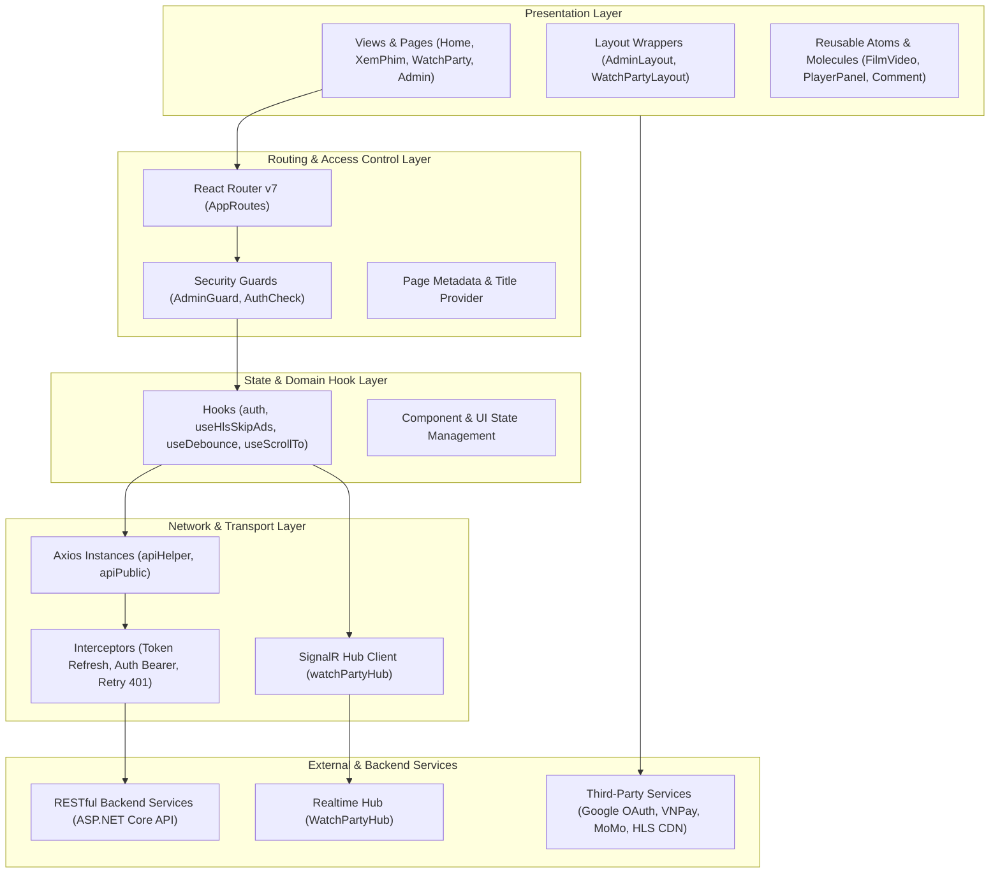
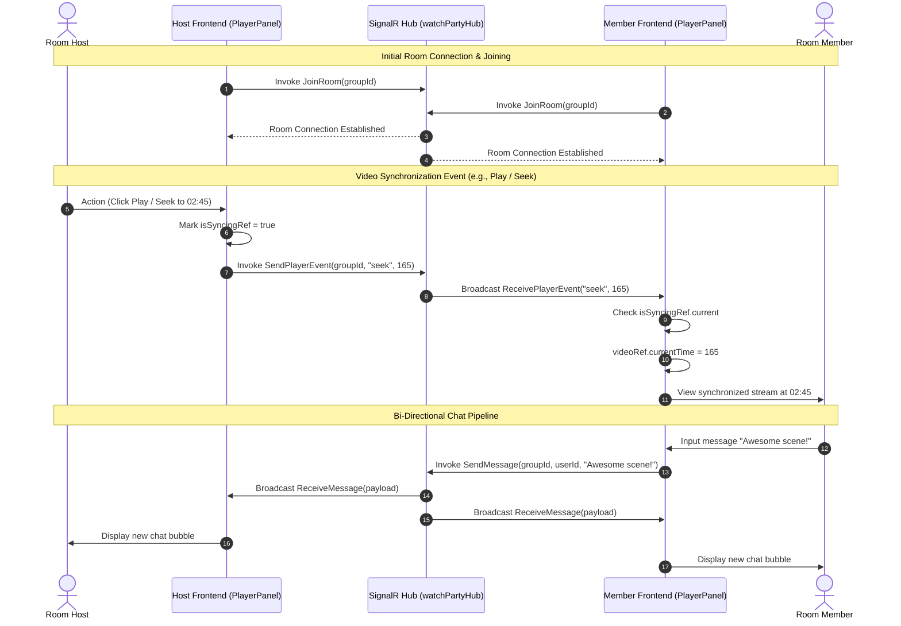
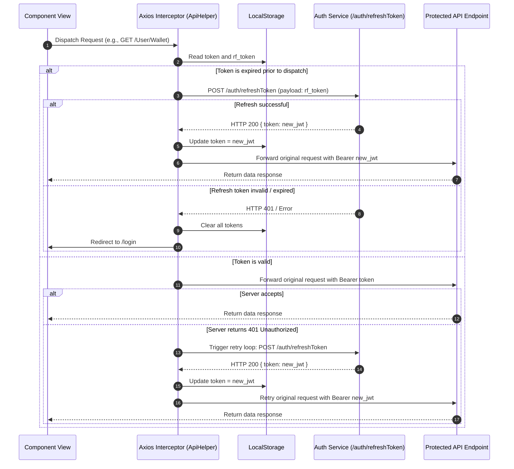

# System Design & Architecture Specification

## 1. System Overview

GienPhim Frontend is an enterprise-grade Single Page Application (SPA) developed to deliver high-concurrency video streaming, collaborative real-time co-watching (WatchParty), subscription billing management, and administrative content management. The architecture enforces separation of concerns through modular component design, isolated API services, centralized token lifecycle management, and bi-directional real-time communication via WebSockets.

---

## 2. Layered Architecture

The client application is organized into five distinct architectural layers:



### 2.1 Layer Descriptions
1. **Presentation Layer**: Implements responsive and interactive interfaces built with React 19, styled using SCSS modules, Tailwind CSS, Ant Design 5, and Bootstrap 5.
2. **Routing and Access Control Layer**: Handles declarative client routing via React Router v7. Includes route guards (`AdminGuard`) to enforce Role-Based Access Control (RBAC) prior to component mounting.
3. **State and Domain Hook Layer**: Encapsulates business logic, video stream processing (`useHlsSkipAds`), JWT parsing (`auth.jsx`), and debounce logic for fast search.
4. **Network and Transport Layer**: Manages outbound HTTP communication through customized Axios instances (`apiPrivate`, `apiPublic`) with automatic JWT refresh token rotation, alongside persistent WebSocket connections via `@microsoft/signalr`.
5. **External and Backend Services**: Interfaces with the upstream ASP.NET Core REST API, SignalR Hub server, Google Identity Services, payment gateways (VNPay, MoMo), and external media CDNs.

---

## 3. Realtime WatchParty Sequence Flow

The WatchParty module coordinates multiple client streams in real-time. When a host modifies playback state (Play, Pause, Seek, Episode Change), the event is dispatched to the SignalR Hub and broadcasted to all room participants.



---

## 4. Authentication and Silent Token Refresh Workflow

The client uses dual-token authentication (Access Token + Refresh Token). The sequence below details the preemptive token check and the reactive 401 retry interceptor loop.



---

## 5. Structural Directory Layout

```
src/
|-- assets/                 # Static graphical assets, typography, and vendor styling
|-- components/             # Reusable UI component modules
|   |-- AdminGuard/         # Role-based route guard for administrative access
|   |-- Commons/            # Atomic elements (Loader, RatingStar, Pagination)
|   |-- Footer/             # Global application footer
|   |-- FormControls/       # Form input elements and schema bindings
|   |-- Header/             # Global header with dynamic search and user status
|   |-- Layouts/            # Complex compound layout structures
|   |   |-- AdminLayout/    # Admin portal wrapper with sidebar navigation
|   |   |-- Comment/        # Nested commenting and review system
|   |   |-- FilmVideo/      # HLS player with custom ad skipping
|   |   `-- WatchPartyLayout/ # Collaborative co-watching room panels
|   |-- Login-container/    # Authentication modal and entry views
|   `-- TitleProvider/      # Document head metadata orchestrator
|-- config/                 # Environment parameters and endpoint resolution
|-- hooks/                  # Custom business and utility React hooks
|-- pages/                  # Route entry points (Home, XemPhim, Admin modules)
|-- routes/                 # Central router definitions (AppRoutes.jsx)
|-- services/               # Isolated HTTP and WebSocket communication layers
|   |-- Admin/              # Management endpoints (Movie, User, Role, Plan, Bot)
|   |-- Auth/               # Core authentication and token management services
|   |-- User/               # Public and member service facades
|   `-- Watch/              # WatchParty and group chat communication services
`-- untils/                 # Network clients, interceptors, and data formatters
```
